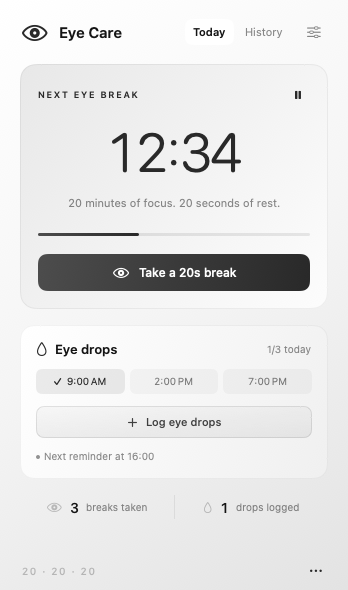
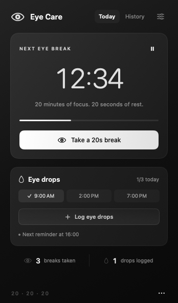

# Eye Care

A free, open-source macOS menu bar app for eye breaks and eye-drop reminders. Native SwiftUI, a monochrome gradient theme, no account, and no tracking.

<p align="center">
  
  
</p>

- A 20-minute focus timer followed by a guided 20-second rest.
- A completion chime so you can rest without watching the timer.
- Scheduled eye-drop reminders, one-click logging, and undo.
- Menu bar indicators for overdue breaks and eye drops.
- Local activity history, automatic pause during sleep or screen lock, and optional launch at login.

[Installation](#installation) · [How it works](#how-it-works) · [Privacy](#privacy) · [Contributing](CONTRIBUTING.md) · [MIT license](LICENSE)

## Installation

**A packaged public release is not available yet.** For now, build the app from source using the steps below.

Requirements:

- macOS 14 or later.
- A Swift 6.0 or newer toolchain, supplied by a compatible Xcode or Apple Command Line Tools installation.
- Apple Silicon is locally verified. Intel builds still need device testing; the build script targets the Mac it runs on rather than producing a universal binary.

Download or clone the source, open Terminal in the project folder, then run:

```sh
bash scripts/build.sh
open "build/Eye Care.app"
```

Click the **eye icon** in the menu bar. Right-click it for pause, log, and quit. The app has no Dock icon. You can copy `build/Eye Care.app` into Applications for everyday use, then enable **Launch at login** in Settings. Keep a single installed copy for predictable login and notification behavior.

The build script creates a local ad hoc signature for development. A future downloadable release needs Developer ID signing and notarization for normal distribution under macOS's default Gatekeeper settings.

## How it works

<p align="center">
  
</p>

*Accelerated demo using fictional activity. A real rest lasts 20 seconds; the animation has no audio.*

- **Eye breaks:** A 20-minute countdown offers a 20-second rest. Click **Take a 20s break**, then look at something 20 feet (about 6 metres) away. Only a finished countdown adds a completed break. Closing the popover keeps the timer running.
- **Completion sound:** A short chime plays when a rest finishes, even with the popover closed. It is enabled by default. Change **Sound when rest ends** in Settings; **Reminder sound** controls upcoming break and eye-drop notification sounds separately.
- **Menu bar indicators:** An exclamation badge means a break is overdue; a droplet means scheduled eye drops are overdue. Both can appear together. Hover over the icon for details.
- **Pause:** Use the pause icon. Sleep and screen lock pause automatically; returning resumes the remaining time. A manual pause stays paused and hides the overdue-break warning. Each app launch starts a new 20-minute session.
- **Snooze:** When a break is due, defer it for five minutes.
- **Eye drops:** Click **Log eye drops** after applying them. Undo an accidental log immediately, or remove it in History. Rapid duplicate logs are blocked for 30 seconds.
- **Daily reminders:** Open Settings, edit the example times, then turn on **Daily reminders**. Up to six times per day. Logging satisfies the earliest unlogged reminder already due, or one within the next 30 minutes. Unscheduled logs are recorded too. Reminder times do not specify dosage.
- **Notifications:** Opt in with **Enable**. Notifications offer **Start rest**, **In 5 minutes**, or **Log eye drops**. macOS notification and Focus settings control banner visibility. The timer, completion chime, and manual logging work without notification permission.
- **History:** Review the last seven days in the app.

Drop notifications are scheduled up to seven days ahead, including while the app is closed. Opening the app refreshes them. A normal quit removes the pending work-break reminder. Run the app each day to keep the reminder queue current. There is no background server or automatic restart after quitting.

## Privacy

Eye Care has no accounts, analytics, advertising, tracking, or app-initiated network requests. It stores settings and activity in:

```text
~/Library/Application Support/EyeCare/data.json
```

Activity is pruned to the most recent 90 days when the running app crosses into a new day. Reminders use macOS's local notification system. Launch at login is optional and uses Apple's ServiceManagement API.

To remove your saved settings and activity, quit Eye Care and delete the `EyeCare` folder at that location. First-open state is also stored in macOS user defaults. Screenshots and the demo above use fictional data.

## Development

```sh
bash scripts/test.sh
bash scripts/build.sh
open "build/Eye Care.app" --args --preview
```

Quit an existing instance before using `--preview`. It opens the production view in a regular window for layout inspection. Launch from the `.app` bundle rather than `swift run`, so macOS notifications have a bundle identity.

The included GitHub Actions workflow is configured to run the test suite, build the app, and check its code signature on Apple Silicon and Intel macOS runners after the repository is pushed to GitHub. Hosted checks do not replace device testing of notification delivery, audio, sleep/lock, or launch at login.

To regenerate the documentation images on macOS, install Pillow into a Python virtual environment and run:

```sh
python3 -m venv .build/docs-venv
source .build/docs-venv/bin/activate
python3 -m pip install Pillow
bash scripts/screenshots.sh
```

The renderer uses the production SwiftUI view with fictional data. It does not read personal history, run timers, or schedule notifications.

See [CONTRIBUTING.md](CONTRIBUTING.md) for contribution and testing guidance, [QA.md](QA.md) for the device verification record, and [PLAN.md](PLAN.md) for the original product scope. Core timer, schedule, and persistence code lives in `Sources/EyeCareCore`; native UI and integrations live in `Sources/EyeCare`.

## License

Eye Care is licensed under the [MIT License](LICENSE).
